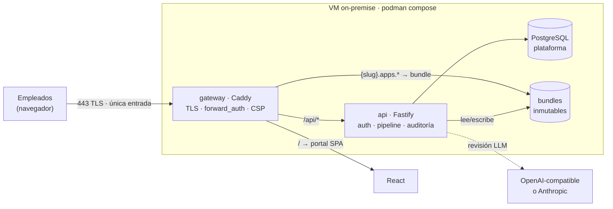

# VibeCraftHub

[English](README.md) | **Español**


**Plataforma self-hosted para que los empleados de una empresa publiquen aplicaciones web internas de forma autónoma y segura** — sin tickets de TI, sin shadow IT, sin abrir puertos en PCs de escritorio.

---

## El problema que resuelve

La IA multiplicó el *shadow IT*: cualquier empleado construye hoy herramientas web útiles en una tarde. Cuando las comparte, su PC pasa de terminal de consumo a **nodo expositor de servicios**, con la infraestructura de la empresa al descubierto.

VibeCraftHub canaliza esa energía por un camino controlado: un catálogo interno donde cualquiera publica sus apps, y un pipeline de seguridad que revisa **cada publicación** antes de que sea visible. TI deja de ser cuello de botella sin perder el control.

## Características

- 📦 **Publicación autónoma** — el empleado sube un zip con su app (html, js, css, json, xml, sqlite opcional); sin intervención de TI.
- 🔍 **Pipeline de revisión en 3 etapas** — estructura (zip-slip, extensiones, binarios disfrazados, límites), reglas estáticas con severidades y revisión semántica con LLM (OpenAI-compatible o Anthropic, cloud o local). Cada rechazo entrega un reporte con archivo, línea y corrección sugerida.
- 🗂️ **Catálogo interno** — las apps se sirven en subdominios aislados con TLS, CSP estricta y sesión obligatoria: una app publicada no puede invocar la API de la plataforma.
- 🧾 **Auditoría completa** — todo intento de publicación (exitoso o rechazado) queda registrado e inmutable, con hallazgos, proveedor LLM, modelo y caché.
- 👥 **Gestión ligera** — usuarios locales con roles, activación/desactivación, reset de contraseñas, política de severidades bloqueantes configurable.
- 🐳 **Un solo comando** — `podman compose up -d --build` en una VM: gateway, API y base de datos.

## Arquitectura



**Modelo de seguridad en profundidad:**

1. **Pipeline** — nada se publica sin pasar estructura, reglas y política de severidades.
2. **Aislamiento de red** — cada app vive en `*.apps.empresa.com`; `forward_auth` exige sesión antes de servir cualquier asset; el dominio del app no alcanza a la API.
3. **CSP estricta** — `default-src 'self'` por app en iframe sandbox: aunque una regla pasara algo, el navegador lo bloquea en runtime.
4. **Cifrado de credenciales** — contraseñas con Argon2id, sesiones httpOnly + Secure, API keys del LLM nunca expuestas (enmascaradas en el panel).

## Inicio rápido

Requisitos: podman ≥ 5 (o docker) y 2 GB RAM.

```bash
git clone https://github.com/danoco78/vibecrafthub.git
cd vibecrafthub/infra
podman compose up -d --build
```

1. Abre `https://localhost:8443` y acepta el certificado de la CA interna de Caddy.
2. **El primer registro se convierte en admin.** Crea cuentas `developer` desde Admin → Usuarios.
3. Publica tu primera app (ver formato del bundle abajo) y aparecerá en `https://<slug>.apps.localhost:8443`.

Guías completas: [operación local](#operación-local-no-perder-datos) · [desarrollo](#desarrollo) · [dominio real](#dominio-real-empresa).

### Operación local (no perder datos)

Los datos viven en volúmenes nombrados (`vibecrafthub_pgdata`, `vibecrafthub_bundles`). El compose fija su nombre de proyecto: parar, arrancar o recrear nunca borra datos.

```bash
podman compose up -d          # arrancar
podman compose stop           # parar (conserva todo)
podman compose start          # reanudar
podman compose down           # quita contenedores, LOS DATOS QUEDAN
podman compose up -d --build  # tras cambiar código del repo
podman volume export vibecrafthub_pgdata -o backup.tar   # backup
```

> ⚠️ Nunca `down -v` ni `podman volume prune`: eso sí elimina usuarios, apps y publicaciones.

### Desarrollo

```bash
pnpm install && pnpm build
pnpm test:scanner                 # 12 tests del pipeline
pnpm dev:api                      # API en :3000 (PGlite embebida, sin docker)
pnpm dev:portal                   # portal en :5173 con hot-reload
```

Pruebas de integración contra el API real: `infra/smoke.sh` (15), `infra/smoke-llm.sh` (13), `infra/smoke-account.sh` (16).

## Formato del bundle

Zip con un `app.json` obligatorio en la raíz:

```json
{
  "name": "inventario",
  "version": "1.0.0",
  "entrypoint": "index.html",
  "description": "Control de inventario de oficina",
  "database": { "file": "data.sqlite", "seed": true }
}
```

- Extensiones permitidas: `html`, `js`, `css`, `json`, `xml`, `sqlite`. Todo lo demás se rechaza.
- `version` es semver y no puede repetirse por app.
- Límites configurables por el admin: 20 MB y 500 archivos por defecto.

## Pipeline de revisión

| Etapa | Qué revisa | Bloqueo |
|---|---|---|
| **1. Estructura** | zip-slip, manifest válido, extensiones permitidas, firmas binarias MZ/ELF, límites | crítico |
| **2. Reglas estáticas** | `eval`/`new Function` y secrets embebidos (crítica) · `innerHTML`, `document.write`, recursos remotos, WebSockets (alta) · `fetch`/XHR externos, service workers (media) · handlers inline, `target=_blank` (baja) | configurable |
| **3. Revisión LLM** | XSS, código ofuscado, exfiltración, lógica maliciosa — con caché por hash de archivo | configurable |

El admin define en el panel qué severidades bloquean y qué hace el pipeline si el LLM no responde (continuar con advertencia o bloquear).

## Configuración

| Variable | Default | Descripción |
|---|---|---|
| `POSTGRES_PASSWORD` | `vch-cambia` | **Cámbiala** antes del primer arranque |
| `PORTAL_HOST` | `portal.vch.local` | Host del portal |
| `APPS_WILDCARD` | `*.apps.vch.local` | Wildcard de las apps |
| `COOKIE_DOMAIN` | `.vch.local` | Domain de la cookie de sesión |
| `COOKIE_SECURE` | `1` | `0` solo para HTTP plano en LAN |
| `APPS_URL_TEMPLATE` | `https://{slug}.apps.vch.local:8443` | Plantilla de URL pública de las apps |

### Dominio real (empresa.com)

- DNS interno con wildcard `*.apps.empresa.com` → la VM.
- En compose: `PORTAL_HOST=portal.empresa.com`, `APPS_WILDCARD=*.apps.empresa.com`, `APPS_ROOT_TEMPLATE=/srv/bundles/{labels.3}/active`, `COOKIE_DOMAIN=.empresa.com`, y el puerto fuera de `APPS_URL_TEMPLATE`.
- Portal y apps deben compartir **dominio base** para que la cookie de sesión funcione.
- Sustituye la CA interna de Caddy por certificados reales si lo prefieres.

### LLM local

Apunta la URL base a tu servidor OpenAI-compatible. Desde contenedor: `http://host.containers.internal:11434/v1` (Ollama), llama.cpp o vLLM. El código nunca sale de la empresa.

## Roadmap

| Versión | Alcance | Estado |
|---|---|---|
| **v0.1** | Catálogo, publicación con pipeline, revisión LLM, auditoría, administración | ✅ esta release |
| **v0.2** | Data gateway: SQLite compartida por app vía SDK, apps privadas con allowlist | diseño listo |
| **v0.3** | Conector LDAP/Active Directory, allowlist de dominios externos | |
| **v1.0** | Métricas de uso, export de auditoría, endurecimiento multi-replica | |

## Licencia

[MIT](LICENSE)
