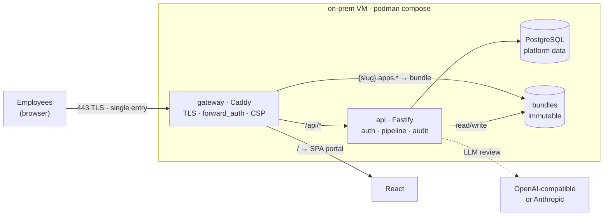

# VibeCraftHub

**English** | [Español](README.es.md)


**Self-hosted platform that lets employees publish internal web applications autonomously and securely** — no IT tickets, no shadow IT, no open ports on desktop PCs.

---

## The problem it solves

AI has multiplied *shadow IT*: today any employee can build a useful web tool in an afternoon. When they share it, their PC turns from a service consumer into a **service-exposing node**, with the company infrastructure wide open.

VibeCraftHub channels that energy down a controlled path: an internal catalog where anyone publishes their apps, and a security pipeline that reviews **every publication** before it becomes visible. IT stops being a bottleneck without losing control.

## Features

- 📦 **Autonomous publishing** — the employee uploads a zip with their app (html, js, css, json, xml, optional sqlite); no IT intervention.
- 🗄️ **Data gateway: SQLite per app** — published apps get real server-side persistence shared by their users via a SDK (`VCH.db`), fully isolated between apps, with configurable quotas and limits.
- 🔒 **Private apps with allowlists** — the owner restricts which specific users can see and use each app; both the catalog and the app subdomain enforce it.
- 🔍 **3-stage review pipeline** — structure (zip-slip, extensions, disguised binaries, limits), severity-graded static rules, and LLM semantic review (OpenAI-compatible or Anthropic, cloud or local). Every rejection returns a report with file, line, and suggested fix.
- 🗂️ **Internal catalog** — apps are served from isolated subdomains with TLS, strict CSP, and mandatory session: a published app cannot call the platform API (only its own `/db/` namespace).
- 🧾 **Full audit trail** — every publish attempt (successful or rejected) is immutably recorded, with findings, LLM provider, model, and cache stats; admin actions on databases too.
- 👥 **Lightweight administration** — local users with roles, activation/deactivation, password resets, configurable blocking-severity policy and gateway limits.
- 🪄 **AI assistant** — a short form in "My apps" generates the exact prompt to hand any AI the app the employee imagines, with the platform's rules already baked in.
- 🐳 **One command** — `podman compose up -d --build` on a single VM: gateway, API, and database.

## Architecture



**Defense in depth:**

1. **Pipeline** — nothing gets published without passing structure, rules, and severity policy.
2. **Network isolation** — each app lives on `*.apps.company.com`; `forward_auth` requires a session before serving any asset; the app domain cannot reach the platform API.
3. **Data isolation** — one SQLite database per app, resolved from the request `Host`: an app can never reach another app's data, not even via SQL.
4. **Strict CSP** — `default-src 'self'` per app inside a sandboxed iframe: even if a rule misses something, the browser blocks it at runtime.
5. **Credential hygiene** — passwords hashed with Argon2id, httpOnly + Secure sessions, LLM API keys never exposed (masked in the admin panel).

## Quick start

Requirements: podman ≥ 5 (or docker) and 2 GB RAM.

```bash
git clone https://github.com/danoco78/vibecrafthub.git
cd vibecrafthub/infra
podman compose up -d --build
```

1. Open `https://localhost:8443` and accept Caddy's internal CA certificate.
2. **The first registered account becomes admin.** Create `developer` accounts from Admin → Users.
3. Publish your first app (see the bundle format below) and it shows up at `https://<slug>.apps.localhost:8443`.

Full guides: [local operation](#local-operation-never-lose-data) · [development](#development) · [real domain](#real-domain-companycom).

### Local operation (never lose data)

Data lives in named volumes (`vibecrafthub_pgdata`, `vibecrafthub_bundles`, `vibecrafthub_appdb`). The compose file pins its project name: stopping, starting, or recreating containers never deletes data.

```bash
podman compose up -d          # start
podman compose stop           # stop (keeps everything)
podman compose start          # resume
podman compose down           # removes containers, DATA IS KEPT
podman compose up -d --build  # after changing repo code
podman volume export vibecrafthub_pgdata -o backup.tar   # backup
```

> ⚠️ Never run `down -v` or `podman volume prune`: that DOES delete users, apps, and publications.

### Development

```bash
pnpm install && pnpm build
pnpm test:scanner                 # 12 pipeline unit tests
pnpm dev:api                      # API on :3000 (embedded PGlite, no docker)
pnpm dev:portal                   # portal on :5173 with hot-reload
```

Integration tests against the real API: `infra/smoke.sh` (15), `infra/smoke-llm.sh` (13), `infra/smoke-account.sh` (16), `infra/smoke-data.sh` (31, data gateway and private apps).

## Data gateway: per-app persistence

Every published app gets **its own SQLite database**, shared by all its users (server-side state, no backend required). Access goes through the platform SDK, same-origin with the app:

```html
<script src="/db/sdk.js"></script>
<script>
  // schema is the app's responsibility
  await VCH.db.run('CREATE TABLE IF NOT EXISTS items (id INTEGER PRIMARY KEY, name TEXT, qty INTEGER)');
  await VCH.db.run('INSERT INTO items (name, qty) VALUES (?, ?)', ['A4 paper', 12]);

  const { rows, truncated } = await VCH.db.all('SELECT * FROM items WHERE qty > ?', [0]);
  const item = await VCH.db.get('SELECT * FROM items WHERE name = :n', { n: 'A4 paper' });
</script>
```

- **Statement allowlist**: `SELECT/INSERT/UPDATE/DELETE` plus table/index/view DDL. Blocked: `ATTACH`, `PRAGMA`, multi-statement.
- **Admin-configurable limits**: quota per app (10 MB), timeout (5 s), rows per response (1,000), queries/min per user (60).
- **Lifecycle**: data persists across app versions; deleting the app deletes its database; admins can download a copy or reset it from the panel.
- Errors surface as `Error` with a stable `.code` (`VCH_DB_QUOTA_EXCEEDED`, `VCH_DB_RATE_LIMITED`, …).

## Bundle format

A zip with a mandatory `app.json` at the root:

```json
{
  "name": "inventory",
  "version": "1.0.0",
  "entrypoint": "index.html",
  "description": "Office inventory tracker",
  "database": { "file": "data.sqlite", "seed": true }
}
```

- Allowed extensions: `html`, `js`, `css`, `json`, `xml`, `sqlite`. Anything else is rejected.
- `version` is semver and cannot repeat per app.
- Admin-configurable limits: 20 MB and 500 files by default.

## Review pipeline

| Stage | What it reviews | Blocking |
|---|---|---|
| **1. Structure** | zip-slip, valid manifest, allowed extensions, MZ/ELF binary signatures, limits | critical |
| **2. Static rules** | `eval`/`new Function` and embedded secrets (critical) · `innerHTML`, `document.write`, remote resources, WebSockets, inline `<script>`, broken HTML references to missing files (high) · external `fetch`/XHR, service workers (medium) · inline handlers, `target=_blank` (low) | configurable |
| **3. LLM review** | XSS, obfuscated code, data exfiltration, malicious logic — cached by file hash | configurable |

The admin defines in the panel which severities block a publication and what the pipeline does when the LLM is unavailable (continue with a warning, or block).

## Configuration

| Variable | Default | Description |
|---|---|---|
| `POSTGRES_PASSWORD` | `vch-cambia` | **Change it** before first start |
| `PORTAL_HOST` | `portal.vch.local` | Portal host |
| `APPS_WILDCARD` | `*.apps.vch.local` | Apps wildcard |
| `APPS_HOST_SUFFIX` | `.apps.vch.local` | Host suffix used by the API to resolve apps in `/db/` |
| `COOKIE_DOMAIN` | `.vch.local` | Session cookie domain |
| `COOKIE_SECURE` | `1` | `0` only for plain-HTTP LAN setups |
| `APPS_URL_TEMPLATE` | `https://{slug}.apps.vch.local:8443` | Public URL template for apps |

### Real domain (company.com)

- Internal DNS with wildcard `*.apps.company.com` → the VM.
- In compose: `PORTAL_HOST=portal.company.com`, `APPS_WILDCARD=*.apps.company.com`, `APPS_HOST_SUFFIX=.apps.company.com`, `APPS_ROOT_TEMPLATE=/srv/bundles/{labels.3}/active`, `COOKIE_DOMAIN=.company.com`, and drop the port from `APPS_URL_TEMPLATE`.
- Portal and apps must share the same **base domain** for the session cookie to work.
- Replace Caddy's internal CA with real certificates if you prefer.

### Local LLM

Point the base URL at your OpenAI-compatible server. From a container: `http://host.containers.internal:11434/v1` (Ollama), llama.cpp, or vLLM. Your code never leaves the company.

## Roadmap

| Version | Scope | Status |
|---|---|---|
| **v0.1** | Catalog, publish pipeline, LLM review, audit trail, administration | ✅ |
| **v0.2** | Data gateway: shared per-app SQLite via SDK, private apps with allowlists | ✅ this release |
| **v0.3** | LDAP/Active Directory connector, external domain allowlist | |
| **v1.0** | Usage metrics, audit export, multi-replica hardening | |

## License

[MIT](LICENSE)
