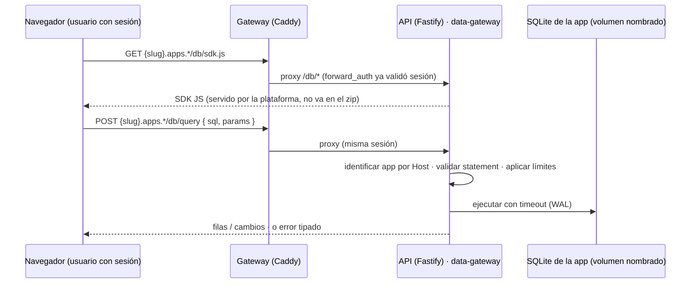

# Diseño v0.2 — Data Gateway y Apps Privadas

Estado: **implementado en feat-v9.2-appsbd (v0.2.0)** — este documento es el contrato del hito; las notas «implementación» reflejan decisiones concretas tomadas durante el desarrollo.
Fecha: 2026-10-17
Alcance: dos features que se publican juntas en v0.2.0.

---

## 1. Objetivos

1. **Data gateway**: que una app publicada tenga persistencia real del lado del servidor — una base de datos SQLite propia por app, compartida entre todos sus usuarios, accedida vía un SDK JS — sin que el developer monte su propio backend.
2. **Apps privadas con allowlist**: que el owner de una app pueda restringir quién puede verla y usarla, seleccionando usuarios concretos.

## 2. Fuera de alcance (no-goals para v0.2)

- Transacciones explícitas multi-request y endpoints batch (candidato a v1.0).
- Allowlist por roles o grupos (llega con LDAP/AD en v0.3).
- Réplica o alta disponibilidad de las SQLite.
- Consultas analíticas / full-text search garantizados (SQLite los soporta, pero sin SLA ni soporte dedicado).
- Auditoría por query (solo se auditan acciones de administración).

## 3. Decisiones registradas

| # | Decisión | Resolución |
|---|---|---|
| 1 | Modelo de datos | Una SQLite **por app**; aislamiento total entre apps. "Compartida" = los usuarios de esa app comparten sus datos |
| 2 | Canal de acceso | SDK JS en la app → endpoints HTTP del módulo data-gateway del API, con la sesión existente |
| 3 | Excepción a la CSP | Ruta `/db/*` **en el propio subdominio de la app**, proxificada por Caddy al API (same-origin; CSP intacta) |
| 4 | Forma de la API | SQL parametrizado con allowlist de statements (no CRUD de alto nivel) |
| 5 | Herramientas de admin | Ver uso, descargar copia y reset de la BD desde el panel, con auditoría |
| 6 | Allowlist | Por **usuario individual** (roles/grupos en v0.3) |
| 7 | Visibilidad inicial | Las apps nuevas nacen **públicas**; hacerlas privadas es optativo |
| 8 | Auditoría del gateway | Solo acciones de admin (descargar/reset) van al log de auditoría |
| 9 | Transacciones | Un statement por request, implícitamente transaccional; sin multi-request en v0.2 |

---

## 4. Feature 1: Data Gateway

### 4.1 Principio de diseño

Hoy la promesa de seguridad es *"una app publicada no puede invocar la API de la plataforma"*. v0.2 la reforma de forma quirúrgica:

> Una app puede invocar la API **únicamente** en `https://{slug}.apps.{dominio}/db/*`, y el gateway solo le deja operar **su propio** archivo SQLite, resuelto por el `Host` de la request.

El resto de la API (`/api/*`) sigue inalcanzable desde el dominio de apps (cross-origin + CSP `default-src 'self'` sin cambios).

### 4.2 Flujo

### 4.3 Superficie HTTP

| Ruta (en el subdominio de la app) | Método | Descripción |
|---|---|---|
| `/db/sdk.js` | GET | SDK JS servido por la plataforma; siempre actualizado |
| `/db/query` | POST | Ejecuta un statement: `{ sql, params?, mode? }` → `{ rows, truncated }` · `{ row }` · `{ changes, lastInsertRowid }` |

| Ruta (en el portal, bajo `/api`) | Método | Descripción |
|---|---|---|
| `PATCH /api/apps/:slug` | PATCH | Ajustes de la app: `visibility`, `description` |
| `GET·POST·DELETE /api/apps/:slug/members[/:userId]` | GET/POST/DELETE | Allowlist de la app (alta por email) |
| `/api/db-config` | GET/PUT | Límites del gateway (cuota, timeout, filas, rate limit) |
| `/api/admin/db-overview` | GET | Uso de BD de todas las apps |
| `/api/admin/apps/:slug/database` | GET | Uso de la BD (tamaño, actualización) |
| `/api/admin/apps/:slug/database/download` | GET | Descarga una copia de la BD (audita) |
| `/api/admin/apps/:slug/database/reset` | POST | Borra los datos de la BD (audita, exige `{"confirm":true}`) |

### 4.4 SDK JS (contrato de interfaz, sin implementación)

Expuesto globalmente como `VCH.db`:

- `VCH.db.all(sql, params?)` → `{ rows, truncated }`
- `VCH.db.get(sql, params?)` → primera fila o `null`
- `VCH.db.run(sql, params?)` → `{ changes, lastInsertRowid }`

Reglas: un statement por llamada; los valores van siempre por `params` (posicionales `?` o nombrados `:nombre`); en dev sin gateway el SDK detecta la base de ruta `/bundles/{slug}/`. Errores tipados con `code` estable (tabla 4.7).

### 4.5 Motor de ejecución

- Un archivo SQLite por app: `DATA_DIR/{slug}/app.db` (lazy: se crea al primer uso). *Implementación: volumen `appdb` dedicado, separado del volumen de bundles para que el flujo de publicación/eliminación de bundles jamás toque datos.*
- Modo **WAL** para lectores concurrentes; escrituras serializadas por el proceso del API; `busy_timeout` configurable.
- **Allowlist de statements**: `SELECT`, `INSERT`, `UPDATE`, `DELETE` y DDL acotado (`CREATE/ALTER/DROP TABLE/INDEX/VIEW`; CTEs con `WITH` se clasifican por su verbo principal). Bloqueados: `ATTACH`, `PRAGMA`, `VACUUM`, múltiples statements por request, extensiones y cualquier verbo fuera del allowlist.
- Timeout por query y límite de filas por respuesta (las lecturas se iteran sin materializar resultados enormes); la escritura se revierte (savepoint + rollback) si supera la cuota verificada con `page_count × page_size`.
- Los errores del motor no filtran rutas ni detalles internos.

### 4.6 Límites (defaults configurables por el admin, como los límites del bundle)

| Límite | Default |
|---|---|
| Cuota de BD por app | 10 MB |
| Timeout por query | 5 s |
| Filas por respuesta | 1 000 |
| Rate limit de `/db/query` | por app y por usuario (valor inicial: 60 req/min, afinar en pruebas) |

### 4.7 Errores tipados

| Código | Situación |
|---|---|
| `VCH_DB_UNAUTHENTICATED` | Sin sesión válida |
| `VCH_DB_FORBIDDEN` | App inactiva, privada sin allowlist, o host no reconocido |
| `VCH_DB_FORBIDDEN_STATEMENT` | Statement fuera del allowlist |
| `VCH_DB_QUOTA_EXCEEDED` | Escritura que supera la cuota |
| `VCH_DB_TIMEOUT` | Query que excede el timeout |
| `VCH_DB_ROW_LIMIT` | Resultado truncado por el límite de filas |
| `VCH_DB_RATE_LIMITED` | Rate limit alcanzado |
| `VCH_DB_INTERNAL` | Error del motor (sin detalles internos) |

### 4.8 Ciclo de vida

| Evento | Efecto sobre la BD |
|---|---|
| Primera query de la app | Se crea (lazy) |
| Publicar / activar nueva versión | **No se toca** (los datos persisten entre versiones; las migraciones de esquema son responsabilidad de la app) |
| Desactivar la app | Intacta; solo deja de servirse |
| Eliminar la app | Se borra junto a los bundles, con confirmación explícita |
| Reset (admin) | Se vacían los datos; la estructura la recrea la app |

### 4.9 Administración y auditoría

- Panel: uso de BD por app (tamaño, última escritura), descargar copia, reset.
- Descargar y reset quedan en el **log de auditoría existente** (acción, admin, fecha). Las queries no se auditan.
- La cuota y los límites se configuran en el panel, junto a la política de publicación actual.

### 4.10 Amenazas consideradas

| Amenaza | Mitigación |
|---|---|
| App A lee la BD de app B | Resolución por `Host` → un solo archivo alcanzable; CSP same-origin; sin `ATTACH` |
| App maliciosa agota recursos de la VM | Cuota, timeout, límite de filas, rate limit, statements permitidos acotados |
| Usuario sin sesión consulta `/db/*` | `forward_auth` + validación de sesión en el gateway |
| Exfiltración masiva vía `SELECT *` | Límite de filas + rate limit |
| Inyección SQL | Autoinfligida por diseño (BD propia); params recomendados por el SDK |

---

## 5. Feature 2: Apps privadas con allowlist

### 5.1 Modelo

- Nueva propiedad por app: `visibility: pública | privada` (default **pública**, decisión #7).
- Las apps privadas tienen una **allowlist de usuarios** de la plataforma (decisión #6).
- El owner de la app y cualquier admin gestionan la allowlist: búsqueda de usuarios, añadir, quitar.

### 5.2 Enforcement en dos capas

1. **Catálogo**: cada usuario ve las apps públicas + las privadas donde figura en la allowlist. El owner y los admins ven además las suyas/gestionables.
2. **Servido del subdominio**: el `forward_auth` existente se extiende para rechazar con **403 y página amigable** (mismo patrón que la 401 actual) a quien no esté autorizado — aplica a assets y a `/db/*` por igual (la BD hereda la protección).

### 5.3 Interacción con el resto

- La visibilidad se elige/actualiza al publicar y en los ajustes de la app.
- No cambia nada del pipeline de revisión ni de la gestión de versiones.
- La eliminación de la app limpia también su allowlist.

---

## 6. Cambios transversales previstos

| Área | Cambio |
|---|---|
| Gateway (Caddy) | Ruta `/db/` en el wildcard de apps → API (después de `forward_auth`) |
| API | Nuevo módulo `datagateway/` (resolución por Host, conexiones SQLite por app, motor SQL, `sdk.js`, rutas admin) |
| Esquema PG | `app_members.created_at` (allowlist ya existía desde 001); tablas `app_databases` (metadatos) y `db_config` (límites, fila única); `admin_actions` (auditoría de admin) |
| Portal | Editor de visibilidad y allowlist; sección de BDs en admin (uso/descargar/reset + límites); página 403 |
| Scanner | Sin cambios (el SQL de la app es runtime, no bundle) |
| Infra | Volumen `appdb` para `DATA_DIR`, junto al de bundles |
| Config | `APPS_HOST_SUFFIX` (resolución por Host); defaults de límites sobreescritos por el panel (`db_config`) |
| Tests | Suite nueva `infra/smoke-data.sh` (31 casos: CRUD SQL, allowlist de statements, truncado, cuota con rollback, apps privadas con Host forjado, admin BD, rate limit) |

---

## 7. Plan de implementación propuesto (orden, sin código)

1. **Fundaciones**: esquema PG (visibilidad, allowlist, metadatos BD) y configuración de límites.
2. **Data-gateway core**: resolución por Host, SQLite por app en WAL, motor con allowlist y límites, errores tipados, `sdk.js`.
3. **Caddy**: proxy `/db/*`.
4. **Apps privadas**: visibilidad, allowlist CRUD, enforcement en catálogo y `forward_auth`, página 403.
5. **Panel de admin**: uso/descargar/reset de BD y límites configurables.
6. **Calidad y docs**: `smoke-data.sh`, suites actualizadas, README bilingüe y CHANGELOG al publicar.

## 8. Preguntas abiertas (se resuelven durante la implementación)

- Valor definitivo del rate limit tras pruebas de carga.
- ¿Compatibilidad del SDK con navegadores objetivo de la empresa (definir baseline)?
- Retención de copias descargadas (hoy: responsabilidad del admin; sin gestión de backups automáticos en v0.2).
