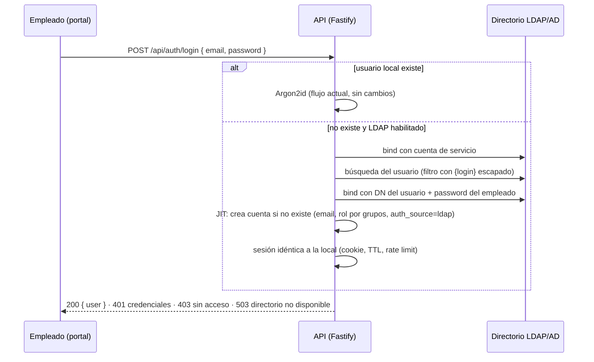
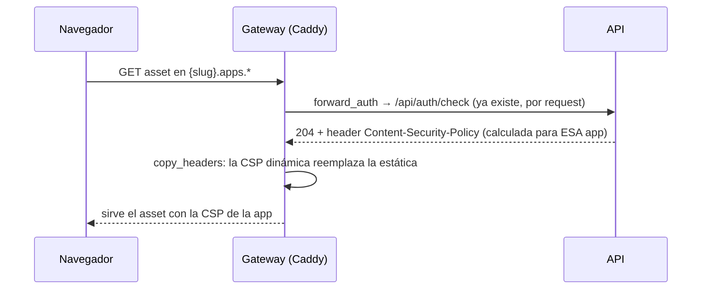

# Diseño v0.3 — Conector LDAP/AD y Allowlist de dominios externos

Estado: **contrato del hito** (implementación pendiente)
Fecha: 2026-10-23
Rama: `v0.3-ldap-integrations-capabilities`
Alcance: dos features que se publican juntas en v0.3.0.

---

## 1. Objetivos

1. **Conector LDAP/AD**: login corporativo contra el directorio de la empresa, coexistiendo con el login local, con provisión just-in-time y roles por grupos.
2. **Allowlist de dominios externos**: el admin aprueba dominios; las apps que los declaran pasan el pipeline y obtienen CSP que les permite consumirlos.

## 2. Fuera de alcance (no-goals para v0.3)

- Import proactivo o sincronización programada de usuarios (v0.3 es JIT + test de conexión).
- Conexiones sin cifrar con el directorio (TLS obligatorio, sin escape).
- Wildcards en la allowlist de dominios (dominios exactos).
- Múltiples directorios simultáneos (una sola configuración LDAP).
- MFA / Kerberos / SAML / OIDC (LDAP directo únicamente).
- Gestión de contraseñas de usuarios LDAP desde la plataforma.

## 3. Decisiones registradas

| # | Decisión | Resolución |
|---|---|---|
| 1 | Coexistencia | Login local **y** LDAP conviven; el local queda como rescate |
| 2 | Provisión | **JIT**: al primer login LDAP exitoso se crea la cuenta con rol mapeado |
| 3 | Roles | **Grupos del directorio → roles** de la plataforma, mapeo configurable por el admin (ordenado, primera coincidencia gana) |
| 4 | Efecto de la allowlist | **Pipeline + CSP por app**: dominio aprobado ⇒ sin hallazgo de scanner y la app obtiene `connect-src`/`img-src` hacia ese dominio |
| 5 | Cifrado del directorio | **TLS obligatorio**: LDAPS (636) o StartTLS; sin escape |
| 6 | Herramientas admin | **Probar conexión**: bind + búsqueda con la config guardada, resultado detallado |
| 7 | Modo de bind | Ambos: cuenta de servicio (bind + búsqueda) o patrón directo de DN con `{login}` |
| 8 | Identidad | `users.auth_source = 'local' \| 'ldap'`; usuarios LDAP sin cambio/restablecimiento de contraseña local |
| 9 | Resiliencia | Directorio caído o que rechaza ⇒ no hay sesión ni fallback; error claro (503/401) |
| 10 | Dominios | Exactos, sin esquema ni puerto (`api.empresa.com`); declarados por la app en `app.json` (`externalDomains`, ya existe) |

---

## 4. Feature 1: Conector LDAP/Active Directory

### 4.1 Principio

El directorio es una fuente de identidad **adicional**, jamás un reemplazo del admin local. La plataforma nunca almacena contraseñas de directorio: autentica haciendo bind con las credenciales del empleado en cada login.

### 4.2 Flujo de login

- Si el usuario existe pero es `auth_source='ldap'`, se re-autentica contra el directorio (nunca contra el hash local). Si un usuario local tiene el mismo email que uno de directorio, gana el local (colisión: login local primero).
- El rate limiting existente (5 fallos por email+IP en 15 min) aplica a ambos orígenes.
- **Protección LDAP-injection**: el login se escapa antes de interpolarse en el filtro (`( ) \ NUL`).

### 4.3 Configuración (`ldap_config`, fila única — patrón `llm_config`)

| Campo | Descripción |
|---|---|
| `enabled` | Interruptor general |
| `mode` | `ldaps` (636) o `starttls` (389 → StartTLS obligatorio) |
| `url` | Host del directorio |
| `base_dn` | DN base de búsqueda (`dc=empresa,dc=com`) |
| `bind_mode` | `service` (cuenta de servicio + búsqueda) o `direct` (patrón de DN con `{login}`) |
| `bind_dn` / `bind_password` | Cuenta de servicio (password en BD, enmascarada en UI — patrón LLM) |
| `user_dn_pattern` | Para modo directo (`uid={login},ou=people,...`) |
| `user_filter` | Filtro de búsqueda con `{login}` (`(&(objectClass=user)(mail={login}))` en AD) |
| `mail_attr` / `group_attr` | Atributos de email y grupos (`mail` / `memberOf`, configurables) |
| `tls_skip_verify` | Solo laboratorios: cifra igual pero no valida el certificado (autofirmados). Default `false` |
| `role_mappings` | JSONB ordenado: `[{ "group": "cn=desarrolladores,...", "role": "developer" }, …]` |
| `default_role` | `user` si ningún grupo coincide |

Presets documentados (no secretos): AD usa `userPrincipalName`/`mail` + `memberOf`; OpenLDAP usa `uid`/`mail` + `memberOf` (overlay) — el atributo de grupos es configurable para cubrir ambos.

### 4.4 Roles por grupos

Al autenticar se leen los grupos del usuario (`group_attr`). El mapeo ordenado decide el rol (primera coincidencia; cada grupo matchea por DN completo **o por CN**, insensible a mayúsculas — cubre las variaciones de formato entre servidores). Sin coincidencias ⇒ `default_role`. El mapeo puede conceder `admin`: es decisión del admin de la plataforma y queda documentada en el panel (el equipo del directorio pasa a controlar quién es admin si así se mapea).

### 4.5 Identidad híbrida

- `users.auth_source`: `local` (default) | `ldap`; `users.ldap_dn` guarda el DN resuelto.
- Usuarios LDAP: **sin** cambio de contraseña propio, **sin** reset de admin (mensaje: "gestionada por el directorio"); el listado del panel muestra el origen.
- Desactivación manual de un usuario LDAP sigue funcionando (mata sesiones; el directorio manda en la entrada, la plataforma en la salida).

### 4.6 Superficie

| Ruta | Método | Descripción |
|---|---|---|
| `/api/ldap-config` | GET/PUT | Configuración (admin; password enmascarada, vacío = conservar) |
| `/api/ldap-config/test` | POST | Bind + búsqueda de prueba (opcionalmente con un login real) → resultado detallado por paso |

### 4.7 Dependencia

`ldapts` (cliente LDAP moderno en TypeScript, mantenido; TLS nativo, StartTLS, control explícito de errores). Credenciales nunca en logs.

---

## 5. Feature 2: Allowlist de dominios externos

### 5.1 Modelo

- Tabla `external_domain_allowlist` (`domain` PK exacto sin esquema/puerto, `note`, `created_at`).
- La app declara sus necesidades en `app.json` → `externalDomains` (campo existente; se normaliza: minúsculas, sin esquema/puerto/ruta).

### 5.2 Pipeline

Al escanear una publicación:

- Todos los `externalDomains` de la app ⊆ allowlist ⇒ **sin hallazgo de dominios** (hoy: hallazgo alto incondicional).
- Algún dominio fuera de la allowlist ⇒ hallazgo alto con mensaje accionable: *"solicita al admin agregar `x.ejemplo.com` a la allowlist"*.
- Las reglas `remote-script/stylesheet/image/iframe`, `remote-fetch`, `xmlhttprequest` y `no-websocket` verifican el host de la URL contra la allowlist: **aprobado ⇒ sin hallazgo**; no aprobado ⇒ hallazgo como hoy.

### 5.3 CSP por app (el mecanismo)

Hoy el gateway fija una CSP estática por sitio. Con la allowlist, cada app necesita su propia CSP. Mecanismo elegido, **sin peticiones extra**:

- `forward_auth` ya se ejecuta por cada asset; `copy_headers` trae la CSP dinámica y sobrescribe la estática (el `header` de Caddy corre antes que `forward_auth` en el orden de directivas).
- Cálculo de la CSP: base estricta de hoy + `connect-src` y `img-src` con `https://domino` por cada dominio aprobado de la **versión activa** de la app. Apps sin dominios ⇒ CSP actual, byte a byte.
- El API cachea en memoria (60 s) la resolución app→dominios aprobados.
- Modo dev (sin Caddy): la ruta `/bundles/:slug/*` del API aplica la misma función de CSP.

### 5.4 Superficie

| Ruta | Método | Descripción |
|---|---|---|
| `/api/admin/external-domains` | GET/POST | Listar y agregar dominio (+nota) |
| `/api/admin/external-domains/:domain` | DELETE | Quitar dominio (las apps afectadas vuelven a hallazgo en su próxima publicación) |
| `/api/apps/:slug` (existente) | GET | Ahora incluye `externalDomains` con estado aprobado/pendiente |

### 5.5 Panel

- Admin → **Dominios externos**: tabla (dominio, nota, fecha) + alta/baja.
- Detalle de app: los `externalDomains` declarados con badge Aprobado/Pendiente.

### 5.6 Seguridad

- La CSP sigue sin `unsafe-inline` para scripts; los dominios solo abren `connect-src` e `img-src`.
- Alta de dominio normalizada y validada (sin esquema, sin puerto, sin ruta, formato hostname).
- Quitar un dominio no rompe apps publicadas: la CSP se recalcula al vuelo, pero un dominio quitado vuelve a ser hallazgo en la **próxima** publicación (documentar en el panel).

---

## 6. Cambios transversales previstos

| Área | Cambio |
|---|---|
| Esquema PG (migración 005) | `users.auth_source`, `users.ldap_dn`, `ldap_config` (fila única), `external_domain_allowlist` |
| API — LDAP | `src/auth/ldap.ts` (cliente sobre `ldapts`: bind service/direct, búsqueda escapada, StartTLS/LDAPS, lectura de grupos) + flujo JIT en login + guard de contraseñas para `auth_source='ldap'` |
| API — dominios | `src/domains/` (allowlist CRUD, resolución app→dominios con caché 60 s, builder de CSP) + `/api/auth/check` devuelve CSP dinámica |
| Scanner | `scanBundle` recibe la allowlist; reglas `remote-*` y `manifest-external-domains` respetan dominios aprobados |
| Gateway | `forward_auth` añade `copy_headers Content-Security-Policy` |
| Portal | Admin → Directorio (config + test) y Dominios externos (CRUD); detalle de app con badges de dominios; LoginPage con nota de login corporativo |
| Tests | `infra/smoke-ldap.sh` con un LDAP desechable en podman (glauth: dos usuarios, dos grupos) cubriendo JIT, roles por grupo, TLS off→lab, 503 con directorio caído; allowlist dentro de `smoke-data.sh` (aprobado/pendiente + CSP) |
| Docs | README bilingüe (login corporativo, allowlist), CHANGELOG 0.3.0, diseño sincronizado |

---

## 7. Plan de implementación propuesto (orden, sin código)

1. **Fundaciones**: migración 005, módulo de configuración LDAP, tabla de allowlist y CRUD.
2. **Scanner + allowlist**: reglas respetan dominios aprobados; `externalDomains` normalizados.
3. **CSP por app**: builder + `/api/auth/check` dinámico + Caddy `copy_headers` + ruta dev.
4. **LDAP client + login JIT**: cliente ldapts, guard de contraseñas, endpoint test.
5. **Portal**: secciones de admin (Directorio, Dominios) y badges por app.
6. **Calidad y docs**: `smoke-ldap.sh`, README bilingüe, CHANGELOG 0.3.0.

## 8. Preguntas abiertas (se resuelven durante la implementación)

- OpenLDAP sin overlay `memberOf`: ¿búsqueda inversa de grupos (`(uniqueMember=dnDelUsuario)`) como segundo modo? Se decide al implementar el lector de grupos.
- ¿Métrica de uso del login LDAP en el panel (entradas por origen)? Encaja con v1.0 (métricas), se pospone.
